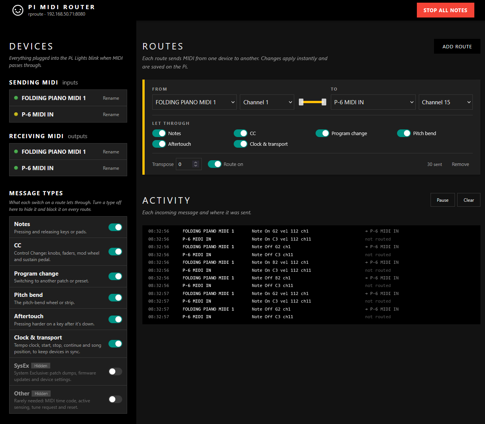

# Pi MIDI Router

Plug USB MIDI gear into a Raspberry Pi and route it from a web page on your phone,
tablet or computer. You can send any device to any other device, keep or change the
MIDI channel, choose which kinds of messages get through, and transpose notes.
Routes are saved on the Pi and come back automatically after a reboot or when a
device is unplugged and plugged in again. Once your routes are set up, you don't need
the web page at all: just power on the Pi and your instruments, and play.



## Quick start (TL;DR)

1. Plug your USB MIDI gear into a Raspberry Pi running Raspberry Pi OS, connected to
   your home network.
2. Get this project onto the Pi (**Code → Download ZIP**), unzip it, and run the
   installer from inside the folder:
   `sudo bash install.sh`
3. On your phone or computer, open the address the installer prints, such as
   `http://midipi.local:8080`, and click **Add route**.
4. That's it. Routes are saved, so after this the Pi just works whenever you switch it
   on, with no web page or computer needed.

Full step-by-step instructions are below.

## What you need

- A Raspberry Pi 3, 4 or 5 (a Pi Zero 2 W also works with a USB OTG adapter and hub)
- Raspberry Pi OS Bookworm or newer. The Lite version (no desktop) is fine.
- Class-compliant USB MIDI devices. Most controllers and synths with a USB port are.
- A powered USB hub if you're connecting several bus-powered devices

## Supported systems

Pi MIDI Router is made for a Raspberry Pi that sits next to your gear and replaces
MIDI cables. The router itself is plain Python, so it can run elsewhere, but the
Raspberry Pi is the main target and the only system with an installer.

| System | Status | Notes |
|---|---|---|
| **Raspberry Pi OS** (Bookworm or newer) | Supported | What it's built for. `install.sh` sets everything up and starts it at boot. |
| **Debian, Ubuntu, Linux Mint** | Should work, untested | Uses the same Linux MIDI system (ALSA) as the Pi. `install.sh` will probably work as-is. |
| **Other Linux** (Fedora, Arch, …) | Should work run by hand, untested | `install.sh` needs `apt`. Run it by hand (see below). |
| **macOS** | Untested | Run it by hand. No start-at-boot setup. |
| **Windows** | Not recommended | Runs, but Windows lets only one program use a MIDI device at a time, so it can't share a controller with your music software. Routes may also not reconnect when a device moves to another USB port. |

To run it by hand on any of these, install Python 3, then from this folder create a
private Python environment, install the two MIDI libraries into it and start the
server:

```
python3 -m venv .venv
.venv/bin/pip install mido python-rtmidi
.venv/bin/python server.py
```

and open http://localhost:8080. Routes are saved in `data/config.json` in this folder.
On Windows, use `python -m venv .venv`, `.venv\Scripts\pip` and `.venv\Scripts\python`
instead. On Debian or Ubuntu, if the first command fails, install
`sudo apt install python3-venv` first.

The private environment is needed because most current systems (including Debian,
Ubuntu and macOS with Homebrew) refuse `pip install` outside one, with an
"externally-managed-environment" error.

## Set up the Pi (skip if it's already running)

1. Use **Raspberry Pi Imager** to write Raspberry Pi OS Lite to the SD card. If you'd
   rather install from the Pi's own desktop (option B below), choose
   **Raspberry Pi OS (with desktop)** instead.
2. In Imager's settings before writing:
   - set the hostname, e.g. `midipi`
   - create a username and password
   - enter your Wi-Fi details, or plan to use an Ethernet cable
   - turn on SSH
3. Put the card in the Pi and power it on. Give it a minute or two to start up.

## Pro tip: make sure the Pi joins your network on its own (If not using LAN)

If your Pi runs without a screen or keyboard, it has to connect to your home network
by itself every time it starts. Otherwise you can't copy files to it, log in to it or
reach the dashboard. Set this up once, using a keyboard and screen plugged into the Pi
or over SSH.

**Wi-Fi.** Save your home Wi-Fi so the Pi reconnects automatically at every start-up.
Replace the network name and password with your own:

```
sudo nmcli device wifi list
sudo nmcli device wifi connect "YourWiFiName" password "YourWiFiPassword"
```

The first command lists the networks the Pi can see. The second connects and saves the
connection. To check it's saved and set to reconnect at start-up:

```
nmcli connection show
sudo nmcli connection modify "YourWiFiName" connection.autoconnect yes
```

**Ethernet cable.** Alternatively, plug a network cable from the Pi into your home
router. That works with no setup and is the most reliable choice, especially for live
use.

**Finding the Pi's address.** The installer prints it when it finishes. To look it up
any time, run this on the Pi:

```
hostname -I
```

`ip addr` shows the same with more detail. `ifconfig` also works if you have installed
it (`sudo apt install net-tools`), since it isn't included in Raspberry Pi OS by default.
Your router can hand the Pi a different address after a restart, so reserve the
address as described under [Open the dashboard](#open-the-dashboard). Wi-Fi and cable
each get their own address, so reserve the one you use.

## Install

The easiest way is to download the project as a ZIP file from GitHub: on the
[project's GitHub page](https://github.com/shan-sherif/pi-midi-router), click
**Code → Download ZIP**. The file is called `pi-midi-router-main.zip`.

There are two ways to get it onto the Pi and install it. Both end the same way.

### Option A: from another computer, over the network

For this option your computer must be able to reach the Pi over your home network,
with both on the same Wi-Fi or connected by cable to the same router. If you're not
sure the Pi is connected, see
[Pro tip: make sure the Pi joins your network on its own](#pro-tip-make-sure-the-pi-joins-your-network-on-its-own-if-not-using-lan)
above.

Download the ZIP on your computer as described above, then copy it to the Pi. Replace
`you` with the username you set and `midipi` with the hostname:

```
scp pi-midi-router-main.zip you@midipi.local:~
```

Then log in to the Pi and run the installer:

```
ssh you@midipi.local
unzip pi-midi-router-main.zip
cd pi-midi-router-main
sudo bash install.sh
```

### Option B: directly on the Pi's desktop

If your Pi has a screen, keyboard and mouse and runs Raspberry Pi OS with desktop, you
can do everything on the Pi itself:

1. Open the web browser on the Pi, go to the
   [project's GitHub page](https://github.com/shan-sherif/pi-midi-router) and click
   **Code → Download ZIP**. It's saved in your **Downloads** folder.
2. Open the **File Manager**, go to **Downloads**, right-click
   `pi-midi-router-main.zip` and choose **Extract Here**.
3. Double-click the new `pi-midi-router-main` folder to open it, then choose
   **Tools → Open Current Folder in Terminal** (or press **F4**).
4. In the terminal window that opens, type this and press Enter (enter your password
   if asked):

   ```
   sudo bash install.sh
   ```

This is the only step that needs typing. After that, open the dashboard in the Pi's own
browser at http://localhost:8080, or from any other device as described below.

### Using git instead

If you're comfortable with git, you can clone the repository on the Pi instead of
downloading the ZIP. The steps above use the ZIP because it's the easiest way to
install.

```
git clone https://github.com/shan-sherif/pi-midi-router.git
cd pi-midi-router
sudo bash install.sh
```

If git isn't installed, add it with `sudo apt install git`. To upgrade later, run
`git pull` in that folder, then `sudo bash install.sh` again.

### After installing

The installer sets up everything, starts the router and makes it start at every boot.
When it finishes it prints the dashboard address.

## Open the dashboard

On any phone, tablet or computer connected to the **same network** as the Pi, go to:

```
http://midipi.local:8080
```

If that doesn't load, use the Pi's IP address instead, e.g. `http://192.168.1.42:8080`.
The installer prints it, and you can see it any time by running `hostname -I` on the Pi.

**Tip:** reserve the Pi's IP address in your home router's DHCP settings (often
called "address reservation" or "static lease"). The address then never changes and
you can bookmark it.

## Using it

On a computer or tablet, **Devices** and **Message types** are in the black column on
the left, with **Routes** and **Activity** on the right. On a phone they're stacked:
Routes, then Devices and Message types, then Activity.

- **Devices** shows everything plugged in. Each device's light blinks when MIDI
  passes through it. Use **Rename** to give a device a nickname such as "Drums".
  An unplugged device is marked *Unplugged*; use **Forget** to remove it from the list
  once no route uses it.
- **Add route** creates a connection. Then choose:
  - **From**: the device sending MIDI and which channel to listen on
    (*All channels*, or just one)
  - **To**: the device receiving MIDI and which channel to send on
    (*Same channel* keeps it unchanged, or pick 1–16 to rewrite it)
  - **Let through**: a switch for each kind of message (notes, CC, program changes,
    pitch bend, aftertouch, clock and transport, SysEx and other messages)
  - **Transpose**: shift notes up or down in semitones
  - **Route on** switch: pause a route without deleting it
  - **Remove**: delete the route (you're asked to confirm first)
- **Message types** (below Devices) explains what each kind of message is. Turn one
  off there to hide its switch and block it on every route, which is handy for types
  you never use, such as SysEx. Turning it back on lets it through on every route again.
- A single source can go to several destinations, and several sources can share one
  destination. Just add more routes.
- **Activity** shows each incoming message and where it was sent.
- **Stop all notes** sends All Notes Off to every device, which fixes stuck notes.
- The **power badge** next to the Pi's address shows whether the Pi is getting enough
  power: *Power OK*, *Low voltage earlier* (it ran short at some point since it
  started) or *Low voltage* (short of power right now). Tap it for advice. It only
  appears on a Raspberry Pi.

Every change applies immediately and is saved on the Pi, so there's no Save button.
You can close the page and the routing keeps working, and everything comes back after
a restart:

- routes, including their channels, transpose, *Route on* and *Let through* switches
- message types hidden under **Message types**
- device nicknames, and unplugged devices you haven't forgotten

The **Activity** log isn't saved. It starts empty each time the Pi starts.

Clock and transport messages have no channel, so they pass through even when a route
listens on a single channel. Switch off *Clock & transport* on the route if you don't
want them.

### Example: controller on channel 1 → synth on channel 3

1. **Add route**
2. From: your controller, *All channels*
3. To: your synth, *Channel 3*

## Troubleshooting

**The page won't load**
- Make sure your phone or computer is on the same network as the Pi. Guest Wi-Fi
  networks usually block devices from seeing each other.
- Try the IP address instead of `midipi.local`. Some Android phones and older Windows
  PCs don't support `.local` names.
- Check the router is running: `sudo systemctl status pi-midi-router`

**A device doesn't show up**
- Run `aconnect -l` on the Pi. If the device isn't listed there, Linux isn't seeing it
  as a MIDI device. Try another cable or a powered hub, and check `lsusb`.
- Some older gear needs a vendor driver that doesn't exist for Linux.

**Devices keep disconnecting, or the power badge says "Low voltage"**

The Pi's USB ports share a limited amount of power. Several bus-powered controllers,
especially ones with lit pads or screens, can use more than the Pi can supply. Signs
are devices dropping out and coming back, stuck or missing notes, or a lightning-bolt
icon on the Pi's desktop. To fix it, try these in order:
- Use the official power supply for your Pi (5.1 V / 3 A for a Pi 4, 27 W for a Pi 5).
  Phone chargers and long, thin cables are the usual cause.
- Plug the controllers into a powered USB hub (one with its own power adapter).
- Power instruments from their own adapters if they have one, so they use USB only
  for MIDI.
- Don't charge a phone from the Pi at the same time.

**Checking it.** The dashboard has a power indicator next to the Pi's address in the
header. It shows *Power OK*, *Low voltage earlier* (the Pi ran short at some point
since it started) or *Low voltage* (short of power right now), and you can tap it for
advice. *Low voltage earlier* stays until the Pi restarts, even after you fix the
cause, so restart the Pi to confirm the fix worked. From the command line,
`vcgencmd get_throttled` shows the same information: `throttled=0x0` means all is well.

**Watch what's happening:** `journalctl -u pi-midi-router -f`

**Change the port:** `sudo bash install.sh --port 9000`

**Upgrade:** download the new ZIP from GitHub, unzip it (`unzip -o` replaces the old
files), and run `sudo bash install.sh` again from the new folder. The installer
says when it finds an existing installation and that the program will be overwritten.
Your routes, device nicknames and port are kept (add `--port` to change the port).

**Remove:** `sudo bash uninstall.sh` (add `--purge` to also delete saved routes)

## Security

There is no password. Anyone on your home network can open the dashboard and change
routes. The router refuses connections from outside your home network, and other
websites can't change your routes from inside your browser. Don't forward the port on
your internet router.

## Try it without a Pi

You can preview the dashboard with pretend devices on any computer with Python 3. From
this folder:

```
python3 -m venv .venv
.venv/bin/pip install mido
.venv/bin/python server.py --demo
```

Then open http://localhost:8080. On Windows, use `python -m venv .venv`,
`.venv\Scripts\pip` and `.venv\Scripts\python` instead.

## Files

| File | What it does |
|---|---|
| `router.py` | Finds MIDI devices and forwards messages according to your routes |
| `server.py` | Web server for the dashboard and its API |
| `static/` | The dashboard page (`index.html`, `app.js`, `style.css`). Its look is based on the W3.CSS "Band" template, with no framework needed |
| `install.sh` / `uninstall.sh` | Set up or remove everything on the Pi |
| `pi-midi-router.service` | Starts the router at boot (installed by `install.sh`) |
| `demo_backend.py` | Pretend devices for `--demo` mode |
| `tests/` | Automated tests: `python3 -m unittest discover tests` |
| `LICENSE` | MIT license |

Installed locations: program in `/opt/pi-midi-router`; saved routes, device nicknames
and hidden message types in `/var/lib/pi-midi-router/config.json`.

## About this project

I started this project to try out Claude Code on something genuinely useful to me: a
quick and easy standalone MIDI router, so I can play my MIDI instruments together
without needing a DAW or a computer running.

My main use is a Roland P-6. To play its samples chromatically from a keyboard, the
notes have to arrive on MIDI channel 15. With a route set to *Channel 15*, any keyboard
can play the P-6 chromatically, whatever channel it sends on. This helps a lot, with
no DAW or other software needed to change the channel.

Pi MIDI Router was written with the help of Claude Opus 5.5, an AI model by Anthropic,
and the result was checked manually.

## License

Released under the [MIT License](LICENSE). You're free to use, change and share it.
